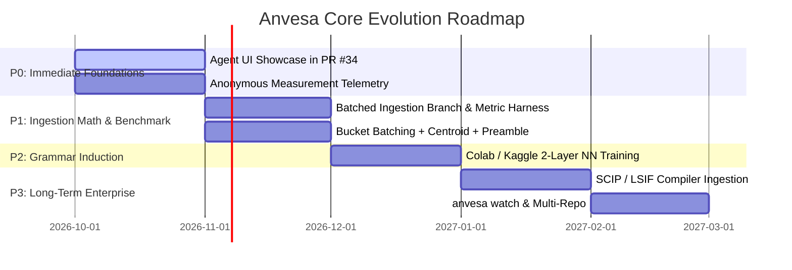

# RFC: Anvesa Core Evolution — The 5 Strategic Pillars

- **Author**: Anvesa Core Team & AI Agent Pair
- **Status**: Proposed / Design Specification
- **Target Version**: `0.8.0` – `0.9.0`
- **Scope**: Telemetry, Auto-Watching, Agent Showcase UI, SCIP/LSIF Ingestion, Non-LLM Grammar Induction, High-Throughput & Precision Ingestion Engine, Multi-Repo Federation

---

## Executive Summary

This RFC outlines the technical architecture, data contracts, and implementation blueprints for the strategic evolution of **Anvesa**:

1. **Anonymous, Non-IP Telemetry**: Privacy-first operational insights with strict zero-PII guarantees.
2. **`anvesa watch` (Continuous Auto-Indexing Daemon)**: Event-driven AST and embedding synchronization with dirty-symbol hashing.
3. **`anvesa ui` Agent Showcase**: URL parameter-driven visual query presentation for AI coding agents (`?search=...`, `?wql=...`, `?symbol=...`).
4. **SCIP/LSIF Ingestion & Non-LLM Grammar Induction**:
   - Compiler-accurate call graphs via SCIP/LSIF protocols.
   - **Non-LLM grammar discovery** using Next-Path Markov transition probabilities and a lightweight 2-hidden-layer Neural Network (~20KB ONNX) trained on Google Colab/Kaggle free runtimes over top 500 OSS repos.
5. **High-Throughput & Precision Ingestion Engine**:
   - **Embedding Calibration without Encoder Retraining**: Centroid subtraction (anisotropy cone flattening), graph-context preamble injection, and late chunking over AST spans.
   - **Ingestion Throughput Optimization**: Length-sorted bucket dynamic batching (3x-5x speedup eliminating zero-padding tensor FLOPs) and 4-stage overlapped asynchronous pipelining.
6. **Multi-Repository Workspace Federation**: Cross-repo retrieval, dependency blast radius, and unified code maps.

---

## Pillar 1: Anonymous & Non-IP Telemetry

### 1.1 Privacy Principles & Guarantees
Anvesa operates in privacy-sensitive enterprise and open-source environments. The telemetry pipeline must adhere to strict invariants:
- **Zero-IP Policy**: Client IP addresses are stripped at the edge proxy and never written to logs or storage.
- **Zero-PII & Zero Code Content**: Never collect file paths, function/class names, code snippets, git commit messages, or raw query text.
- **Strict Opt-Out & Audit Mode**:
  - `ANVESA_NO_TELEMETRY=1` or `ANVESA_NO_NETWORK=1` blocks the subsystem entirely.
  - Configuration `"telemetry": false` in `.anvesa/config.json`.
  - CLI flag `--no-network` terminates with an error if network dispatch is attempted.
- **Ephemeral Session Identifiers**: A randomly generated UUID rotated every 24 hours. No persistent hardware UUIDs or MAC address hashes.

### 1.2 Event Payload Schema
```typescript
export interface TelemetryPayload {
  readonly schemaVersion: '1.0.0';
  readonly sessionId: string; // Rotated daily
  readonly timestamp: number;
  readonly anvesaVersion: string;
  readonly platform: {
    readonly os: 'linux' | 'darwin' | 'win32';
    readonly arch: 'x64' | 'arm64';
    readonly cpuCores: number;
    readonly totalMemoryGbBucket: '2-4' | '4-8' | '8-16' | '16-32' | '32+';
  };
  readonly event: {
    readonly type: 'cli_command' | 'mcp_tool_call' | 'index_completed' | 'error';
    readonly commandName: string; // e.g. "search", "query", "callers"
    readonly durationMsBucket: '<10' | '10-50' | '50-200' | '200-1000' | '1000+';
    readonly modelId?: string; // e.g. "bge-base-en-v1.5"
    readonly resultCountBucket?: '0' | '1-5' | '6-20' | '20+';
    readonly errorCode?: string; // e.g. "CORE_INVALID_ARGUMENT" (no stack traces)
    readonly optionsUsed?: {
      readonly hasScope: boolean;
      readonly hasWqlConjunction: boolean;
      readonly customWeights: boolean;
    };
  };
}
```

### 1.3 Transport & Resilience
- **Non-blocking Batching**: Events are queued in a small memory ring-buffer (max 50 events).
- **Asynchronous Dispatch**: Flushed every 60 seconds or on graceful process exit using `fetch()` with an aggressive 600ms timeout.
- **Failure Handling**: Network errors are silently discarded; telemetry may never slow down or crash a CLI command.

---

## Pillar 2: `anvesa watch` (Continuous Auto-Indexing Daemon)

### 2.1 Problem Statement
Currently, Anvesa's index reflects the moment `anvesa index` was run. As human developers or autonomous AI agents create, refactor, and delete files, the vector store and code graph drift.

### 2.2 System Architecture
```
┌────────────────────────────────────────────────────────┐
│                   File System Watcher                  │
│       (ReadDirectoryChangesW / inotify / FSEvents)     │
└───────────────────────────┬────────────────────────────┘
                            │ Raw Path Events
                            ▼
┌────────────────────────────────────────────────────────┐
│             Pre-Filter (.anvesaignore / .git)          │
└───────────────────────────┬────────────────────────────┘
                            │ Filtered Dirty Paths
                            ▼
┌────────────────────────────────────────────────────────┐
│            Debounce Window (Default: 300ms)            │
└───────────────────────────┬────────────────────────────┘
                            │ Batched Changed Files
                            ▼
┌────────────────────────────────────────────────────────┐
│               Incremental AST Analyzer                 │
│      - Parse changed files with Tree-Sitter            │
│      - Compute symbol hash deltas                      │
└───────────────────────────┬────────────────────────────┘
                            │ Modified Symbol Cards Only
                            ▼
┌────────────────────────────────────────────────────────┐
│           Red-Team Safety Screen Gate                  │
└───────────────────────────┬────────────────────────────┘
                            │ Clean Cards
                            ▼
┌────────────────────────────────────────────────────────┐
│          Incremental SQLite & Vector Update            │
│      - Re-embed modified symbol cards                  │
│      - Prune removed symbol cards                      │
│      - Reconcile call and import graph edges           │
└────────────────────────────────────────────────────────┘
```

### 2.3 Implementation Details
1. **CLI Command**:
   ```bash
   anvesa watch [--debounce-ms 300] [--no-embed] [--scope <dir>]
   ```
2. **Embedded Watcher Mode**:
   - `anvesa mcp serve --watch`: Keeps the index warm for coding agents during active pair-programming sessions.
   - `anvesa ui --watch`: Automatically updates the web dashboard graph and search index in real time.
3. **Dirty Symbol Hashing**:
   - Each symbol card stores a BLAKE3/SHA-256 hash of its source text slice: `hash(kind + signature + body)`.
   - If a file modification only changes comments or formatting outside a function, the function's embedding is untouched, saving significant compute.

---

## Pillar 3: `anvesa ui` — Agent Showcase via Query Parameters

### 3.1 Objective
Allow AI coding agents to visually present their search results, call graphs, and architectural findings to the human developer with a single URL or CLI command.

### 3.2 URL Parameter Specification
The web dashboard router parses query parameters on load and updates reactive state:

| Parameter | Type | Description | Example |
| :--- | :--- | :--- | :--- |
| `q` / `search` | `string` | Query text to execute in Search Studio | `?q=authentication+token` |
| `mode` | `enum` | Search mode: `fused`, `semantic`, `structural` | `&mode=fused` |
| `wql` | `string` | Conjunction WQL structural predicate | `&wql=//class//method` |
| `weightDocs` | `number` | Documentation channel weight ($0.0 - 2.0$) | `&weightDocs=0.5` |
| `scope` | `string` | Directory path scope constraint | `&scope=packages/retriever` |
| `view` | `enum` | Target tab: `search`, `graph`, `wql`, `status` | `&view=graph` |
| `symbol` | `string` | Target symbol to center in Call Graph | `&symbol=Retriever.search` |
| `repomap` | `boolean` | Open PageRank Architectural Repomap | `&repomap=true` |
| `highlight` | `string` | Specific card ID to pulse and scroll into view | `&highlight=sym:retriever:fuse` |

### 3.3 CLI Invocation
```bash
# Agent opens browser showcasing specific search results:
anvesa ui --search "parse configuration" --wql "//function"

# Agent opens browser centered on a complex symbol's call hierarchy:
anvesa ui --view graph --symbol "Retriever.search"
```

### 3.4 MCP Tool Addition (`open_ui`)
Register an MCP tool in `cli/src/mcp.ts`:
```typescript
server.registerTool('show_in_ui', {
  description: 'Open the Anvesa visual web dashboard in the human user\'s browser to showcase code search results, a symbol call graph, or an architectural repomap.',
  inputSchema: {
    query: z.string().optional(),
    symbol: z.string().optional(),
    wql: z.string().optional(),
    view: z.enum(['search', 'graph', 'wql', 'status']).optional(),
  }
}, async (args) => {
  const url = buildUiUrl(args);
  await openBrowser(url);
  return { content: [{ type: 'text', text: `Opened Anvesa Dashboard at ${url}` }] };
});
```

---

## Pillar 4: SCIP/LSIF Ingestion & Open-Source Grammar Training

### 4.1 Hybrid Graph Architecture: AST + Compiler Precision
While Tree-Sitter AST outlines are fast, offline, and language-agnostic, they lack semantic type resolution for complex generics, cross-file re-exports, and dynamic method dispatches.

```
                  ┌───────────────────────────────┐
                  │      Source Code Workspace    │
                  └──────────────┬────────────────┘
                                 │
                 ┌───────────────┴───────────────┐
                 ▼                               ▼
    ┌─────────────────────────┐     ┌─────────────────────────┐
    │  Tree-Sitter Syntax AST │     │   SCIP / LSIF Compiler  │
    │   (Fast, 14+ Languages) │     │ (rust-analyzer, tsc, Go)│
    └────────────┬────────────┘     └────────────┬────────────┘
                 │ Syntactic Edges               │ Verified Type References
                 └───────────────┬───────────────┘
                                 ▼
    ┌─────────────────────────────────────────────────────────┐
    │              Unified Graph Knowledge Base               │
    │  - Edges tagged: { accuracy: "compiler" | "syntactic" } │
    │  - Callers / Callees / Dependents unified queries       │
    └─────────────────────────────────────────────────────────┘
```

### 4.2 Ingestion Engine (`anvesa graph import`)
- **Format Support**:
  - SCIP (Source Code Intelligence Protocol) protobuf (`index.scip`).
  - LSIF JSON lines (`dump.lsif`).
- **Schema Mapping**:
  - SCIP `SymbolInformation` -> Anvesa `symbols` table (`name`, `kind`, `signature`, `doc`).
  - SCIP `Occurrence` (`definition` / `reference`) -> Anvesa `edges` table (`caller_id`, `callee_id`, `kind`, `accuracy: "compiler"`).
- **Fallback Resolution**: Queries to `anvesa callers` prioritize `compiler` edges, falling back to AST pattern edges when SCIP data is unavailable.

### 4.3 Automated OSS Grammar Induction & Free Cloud Runtimes

#### 4.3.1 Eliminating LLMs from Grammar Induction
In `structural/src/training.ts`, Anvesa currently defines an `Assistant` callback meant for external LLM calls. However, using LLMs for AST syntax mapping introduces non-determinism, slow network roundtrips, high cost, and syntax hallucinations. 

Because ASTs are deterministic hierarchical graphs, we replace LLM calls with **deterministic Next-Path Transition Probabilities** and a **lightweight 2-hidden-layer Neural Network (MLP)**.

```
                           ┌──────────────────────────────────────────────┐
                           │   Tree-Sitter AST Topology (training.ts)     │
                           │  - Fields (name, body, params, args, type)   │
                           │  - Parents & Ancestors                       │
                           │  - Child node types & nameShare              │
                           └──────────────────────┬───────────────────────┘
                                                  │
                      ┌───────────────────────────┴───────────────────────────┐
                      ▼                                                       ▼
        [Approach A: Path Model]                                [Approach B: 2-Layer NN]
     Next-Path Transition Probability                         Multi-Layer Perceptron (MLP)
   P(Role | Parent, Child, Fields)                                128 -> 64 -> 32 -> 18
              │                                                               │
              ▼                                                               ▼
   Deterministic Tag Prediction                                  < 25 KB ONNX Model in CLI
```

#### 4.3.2 Free Cloud Runtime Execution Strategy
Extracting syntax topology across the top 500 OSS repositories in target languages (e.g. Kotlin, Zig, Swift, Elixir, C#) is **CPU- and memory-bound**, not GPU-bound.
- **Runtime Targets**: Google Colab (2 vCPU, 12.7 GB RAM) or Kaggle Kernels (4 vCPU, 30 GB RAM, 30h/week free).
- **Pipeline**:
  1. Headless download of repo source archives using GitHub Archive / BigCode stacks.
  2. Multi-threaded Tree-Sitter AST walk using `inspectTopology` to count parent-field-child co-occurrences.
  3. Output a compressed `topology-<lang>.json` (< 500 KB) and automated mapping candidates.

#### 4.3.3 Model Architecture A: Next-Path Transition Probability (Markov / PCFG)
An AST follows strict syntactic transition idioms. For any unmapped node $X$, its semantic role probability is determined by its transition likelihood:
$$P(\text{Role} = r \mid \text{Parent}, \text{Field\_Signature}, \text{Child\_Set}) = \frac{C(\text{Parent}, \text{Field\_Sig}, \text{Child\_Set}, r) + \alpha}{\sum_{r'} (C(\text{Parent}, \text{Field\_Sig}, \text{Child\_Set}, r') + \alpha)}$$
Where $\alpha = 0.1$ is Laplace smoothing. Empirical co-occurrence counting over top OSS repos resolves > 90% of AST node roles with mathematical certainty and zero hallucinations.

#### 4.3.4 Model Architecture B: 2-Hidden-Layer Neural Network (MLP Classifier)
For ambiguous or polymorphic syntax nodes, a 2-hidden-layer MLP predicts semantic tags directly from `AssistCandidate` topological features:
- **Input Features ($x \in \mathbb{R}^{128}$)**:
  - 32 binary flags for structural field occurrences (`name`, `body`, `parameters`, `arguments`, `type`, etc.).
  - 16 continuous statistics: `nameShare` ($\in [0, 1]$), `file_spread`, $\log(\text{frequency})$, leaf-to-branch ratio.
  - 80 bag-of-words context embeddings representing top-5 parent types and top-5 child types.
- **Network Dimensions**:
  $$\text{Input}(128) \xrightarrow{W_1} \text{Dense}(64) \xrightarrow{\text{GELU + LayerNorm}} \text{Dense}(32) \xrightarrow{\text{GELU}} \text{Output}(18)$$
- **Supervision & Zero-Manual-Labeling**:
  Trained on Google Colab in **under 15 seconds** using Anvesa's 9 existing ground-truth canonical language mappings (`typescript`, `python`, `rust`, `go`, `java`, `cpp`, `c`, `php`, `ruby`) as training labels ($\approx 50,000$ AST node samples).
- **Distribution**: Exported as a tiny **~22 KB ONNX model**, executed locally inside the CLI via ONNX Runtime with sub-millisecond latency.

---

## Pillar 5: High-Throughput & Precision Ingestion Engine

### 5.1 Enhancing Dense Embeddings Without Retraining the Encoder
When using fixed local ONNX models (e.g. `bge-small-en-v1.5`, `all-MiniLM-L6-v2`) or remote APIs, ingestion-time mathematical calibration significantly enhances search precision:

1. **Vector Centroid Subtraction (Anisotropy Whitening)**:
   - Pretrained transformers suffer from the "anisotropy cone problem", where all code vectors cluster into a narrow angular cone with high baseline similarity ($0.75 - 0.85$).
   - During indexing, compute the running codebase centroid: $\mu = \frac{1}{N} \sum_{i=1}^N v_i$.
   - Store normalized zero-centered vectors: $\tilde{v}_i = \frac{v_i - \mu}{\|v_i - \mu\|_2}$.
   - At query time, subtract the stored $\mu$ from the query vector before dot-product scoring.
   - **Result**: Spreads representations across the unit hypersphere, dramatically boosting cosine discriminability between distinct symbols.

2. **Graph-Context Preamble Injection (Topological Conditioning)**:
   - For generic symbol names (e.g. `validate()`, `handle()`), synthesize a 2-line metadata preamble prior to embedding:
     ```typescript
     // [Scope]: class PaymentGateway | implements IPaymentProcessor
     // [Calls]: StripeClient.charge, Tokenizer.sanitize | [Called By]: CheckoutController.submit
     ```
   - Transformer self-attention attends to these topological anchors, clustering related architecture components in vector space without retraining.

3. **Late Chunking over AST Spans**:
   - Compute token-level hidden states $H \in \mathbb{R}^{T \times D}$ over whole file buffers, then slice token embeddings using Tree-Sitter symbol spans $[start, end]$ before mean pooling. Preserves file-level import context in each symbol vector.

### 5.2 Accelerating Ingestion Throughput

1. **Length-Sorted Bucket Dynamic Batching**:
   - In naive batching, batches containing both short (32 tokens) and long (512 tokens) cards waste > 80% of tensor compute on zero-padding.
   - **Algorithm**:
     - Sort extracted cards by token length $L_i$.
     - Partition into discrete buckets: Bucket 1 ($L \le 64$), Bucket 2 ($65-192$), Bucket 3 ($193-384$), Bucket 4 ($385-512$).
     - Execute batched tensor inference per bucket with inverse batch sizing (e.g., batch 64 for short, batch 8 for long).
     - Restore original sequence using tracked indices.
   - **Throughput Gain**: **3x to 5x faster** on CPU/GPU with zero floating-point error.

2. **4-Stage Overlapped Asynchronous Pipeline**:
   - Overlap stages across a double-buffered producer-consumer queue:
     $$\text{Disk I/O \& Hashing} \longrightarrow \text{Tree-Sitter Parsing} \longrightarrow \text{ONNX Tensor Inference} \longrightarrow \text{SQLite WAL Batch Write}$$
   - Eliminates pipeline stalls, keeping both CPU parsing threads and ONNX SIMD execution at 100% saturation.

3. **Content-Addressable Vector Deduplication**:
   - Hash normalized AST structures (stripping comments and whitespace). Duplicate boilerplate methods share vector IDs, bypassing tensor inference entirely.

---

## Pillar 6: Multi-Repository Workspace Federation

### 6.1 Architecture & Federation Topology
In enterprise environments, microservices, polyrepos, and modular libraries span multiple repositories that depend on each other.

```
                            ┌────────────────────────┐
                            │   Root Workspace / UI  │
                            └───────────┬────────────┘
                                        │
             ┌──────────────────────────┼──────────────────────────┐
             ▼                          ▼                          ▼
    ┌──────────────────┐       ┌──────────────────┐       ┌──────────────────┐
    │   Repo 1: API    │       │  Repo 2: Client  │       │  Repo 3: Types   │
    │ (.anvesa/index)  │       │ (.anvesa/index)  │       │ (.anvesa/index)  │
    └──────────────────┘       └──────────────────┘       └──────────────────┘
```

### 6.2 Workspace Manifest (`.anvesa/workspace.json`)
```json
{
  "version": 1,
  "federation": {
    "enabled": true,
    "repositories": [
      {
        "name": "core-api",
        "path": "../backend-service",
        "defaultLanes": ["symbols", "docs"]
      },
      {
        "name": "web-frontend",
        "path": "../frontend-app",
        "defaultLanes": ["symbols"]
      },
      {
        "name": "shared-contracts",
        "path": "../contracts",
        "defaultLanes": ["symbols", "docs"]
      }
    ]
  }
}
```

### 6.3 Federated Retrieval Execution
1. **Fan-Out Query Dispatch**: `Retriever.search()` executes parallel queries against each federated repository's index.
2. **Provenance-Preserving RRF Fusion**:
   - Each hit includes a repository identifier: `{ repo: "core-api", path: "src/auth.ts", symbol: "verifyJwt" }`.
   - Results are fused across repository boundaries with optional per-repository weighting (`--weight repo:core-api=1.5`).
3. **Cross-Repository Blast Radius (`anvesa dependents`)**:
   - Detects when changes to `shared-contracts` break method signatures used in `core-api` and `web-frontend`.

---

## Prioritization & ROI Matrix

Updated based on team alignment and objective measurement priorities:

| Initiative | Impact | Effort | Risk | Dependencies | Aligned Priority | Notes |
| :--- | :--- | :--- | :--- | :--- | :--- | :--- |
| **Agent UI Showcase (`?search=...`)** | High | Low | Low | PR #34 (`anvesa-ui`) | **P0 (Immediate)** | Implemented directly inside PR #34 (no new branch needed). |
| **Anonymous Telemetry (Non-IP)** | High | Low | Low | Edge endpoint | **P0 (Immediate)** | Critical measurement baseline to objectively compare search & grammar quality before/after. |
| **Ingestion Optimization Trio**<br>*(Bucket Batching + Centroid Calibration + Graph Preamble)* | High | Medium | Medium | `dense/embedder.ts`, facts | **P1 (Batched Experiment)** | Grouped into a single branch/worktree with an objective mathematical validation & benchmark harness. |
| **Non-LLM 2-Layer NN on Colab** | High | Medium | Low | Colab notebook, ONNX | **P2** | Train on 500 OSS repos to induce grammars without LLMs. |
| **`anvesa watch` (Daemon & MCP)** | Low | Medium | Medium | FS watcher, AST diffing | **P3 (De-prioritized)** | Consequent runs of `anvesa index` are already fast; file-watch daemon is deferred. |
| **SCIP Compiler Ingestion** | High | High | Medium | SCIP protobuf parser | **P3** | Long-term precision for compiler-level type graphs. |
| **Multi-Repo Federation** | High | High | High | Workspace resolver | **P4** | Cross-repo retrieval mesh for enterprise polyrepos. |

---

## Phased Implementation Roadmap



---

## Verification & Safety Invariants

1. **Zero External Runtime Dependencies**: All features must remain native Bun/Node compatible, self-contained within the Anvesa binary package.
2. **Red-Team Boundary Preserved**: Telemetry, watcher events, and federated cards must continue to pass through the Red-Team screening gate before entering any vector store.
3. **Offline Default**: Anvesa must continue to be 100% functional without internet connectivity.
