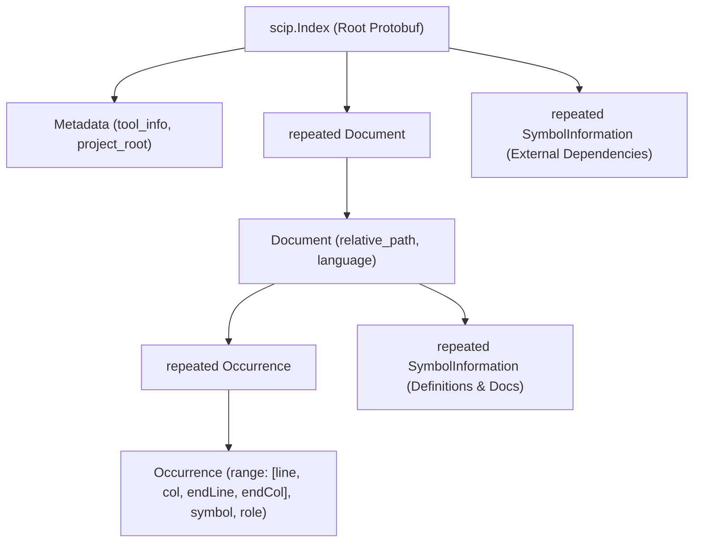
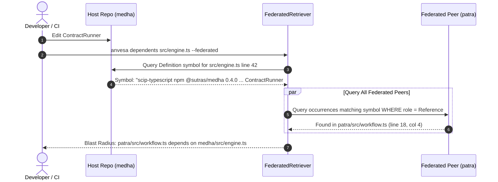

# SCIP Ingestion in Anvesa: Compiler-Grade Cross-Repository Code Intelligence

> [!NOTE]
> This specification defines the architecture, data model, database schema, and query execution engine for ingesting **SCIP** (*Source Code Intelligence Protocol*) indexes into Anvesa to enable 100% deterministic, compiler-grade cross-repository code graphs and blast-radius analysis.

---

## 1. Executive Summary & Problem Context

### The Polyrepo Graph Dilemma
Modern software architectures increasingly rely on multi-repository or polyrepo structures (e.g., the `sutras/` ecosystem with `anvesa`, `medha`, `patra`, and `sage`). In a single monolithic repository, jump-to-definition and caller/callee relationships can be partially resolved using relative filesystem paths. 

However, across repository boundaries, fundamental breakdown occurs:
1. **Opaque Package Boundaries**: Repository `patra` imports `@sutras/medha`. From `patra`'s filesystem perspective, that code resides in a minified `node_modules/` bundle or lockfile, not in `../medha/src/`.
2. **Dynamic Name Collisions**: Heuristic AST parsers (such as Tree-Sitter) cannot know with certainty whether `runner.execute()` calls `MedhaRunner.execute()` or an arbitrary local object without running a full type checker.
3. **The LSP Impasse**: Running Language Server Protocol (LSP) daemons (`tsserver`, `rust-analyzer`) across dozens of polyrepos in background processes exhausts machine memory (1–4 GB RAM per repo), suffers from cold-start latency, and fails to link cross-workspace symbols natively.

### The Solution: SCIP as the Deterministic Bridge
**SCIP** (*Source Code Intelligence Protocol*), developed by Sourcegraph as the high-performance successor to Microsoft's LSIF, provides the exact abstraction needed:
- **Stateless & Immutable**: Emitted once during build/CI as a compact Protocol Buffers file (`index.scip`).
- **Deterministic Universal Symbols**: Assigns a globally unique string URI to every symbol across repositories, versions, and package managers.
- **Zero-RAM at Rest**: Can be ingested directly into Anvesa's local SQLite store (`.anvesa/index.db`) and queried in **sub-millisecond (< 1ms)** time.

---

## 2. The SCIP Protocol Data Model

Unlike LSIF (which serialized graph vertices and edges into massive 10GB–50GB JSON files), SCIP uses a **document-oriented Protocol Buffers schema** designed for linear streaming and high compression (typically 10x smaller).



### 2.1 The Global Symbol Naming Standard
The linchpin of cross-repository graph resolution is the **SCIP Universal Symbol String**:

$$\text{Symbol} = \langle\text{scheme}\rangle\text{ }\langle\text{package-manager}\rangle\text{ }\langle\text{package-name}\rangle\text{ }\langle\text{version}\rangle\text{ }\langle\text{descriptor}\rangle$$

#### Descriptor Syntax
Descriptors form a hierarchical path using typed delimiters:
- `/` = Namespace / Directory / File
- `#` = Type / Class / Interface
- `()` = Method / Function
- `.` = Term / Property / Field
- `::` = Type parameter

#### Concrete Examples
* **TypeScript / Node (`scip-typescript`)**:
  ```text
  scip-typescript npm @sutras/medha 0.4.0 src/engine.ts/ContractRunner#execute().
  ```
* **Rust / Cargo (`rust-analyzer scip`)**:
  ```text
  scip-cargo cargo anvesa-store 0.7.4 src/reader.rs/IndexReader#open().
  ```
* **Go (`scip-go`)**:
  ```text
  scip-go gomod github.com/sutras/sage v1.2.0 pkg/eval/Evaluator#Eval().
  ```

---

## 3. Anvesa Ingestion Architecture

Anvesa does not force users to set up heavy compiler toolchains. Instead, it adopts a **Hybrid Overlay Model**:

```
                       ┌────────────────────────────────────────┐
                       │           Source Code Files            │
                       └───────────────────┬────────────────────┘
                                           │
                    ┌──────────────────────┴──────────────────────┐
                    ▼                                             ▼
       ┌────────────────────────┐                    ┌────────────────────────┐
       │   Tree-Sitter Engine   │                    │     SCIP Indexers      │
       │  (Built-in, Instant)   │                    │ (scip-typescript, etc.)│
       └────────────┬───────────┘                    └────────────┬───────────┘
                    │ Structural Wexpr Cards                      │ index.scip (Protobuf)
                    │ (AST Outline, Fallback)                     │ (Compiler-Grade Facts)
                    ▼                                             ▼
       ┌──────────────────────────────────────────────────────────────────────┐
       │                      Anvesa Store (.anvesa/index.db)                 │
       │                                                                      │
       │  TABLE symbols (wexpr outline, docstrings, vector embeddings)       │
       │  TABLE scip_symbols (global namespaced symbol strings)               │
       │  TABLE scip_occurrences (definitions, references, implementations)   │
       └──────────────────────────────────┬───────────────────────────────────┘
                                          │
                        ┌─────────────────┴─────────────────┐
                        │        FederatedRetriever         │
                        └─────────────────┬─────────────────┘
                                          │
       ┌──────────────────────────────────┴───────────────────────────────────┐
       │ 1. anvesa callers <symbol> --federated                               │
       │ 2. anvesa dependents <path> --federated (100% Exact Blast Radius)    │
       │ 3. anvesa repomap --federated (Unified Multi-Repo Graph)             │
       └──────────────────────────────────────────────────────────────────────┘
```

### 3.1 Dual-Track Operation
1. **Fast Track (Tree-Sitter & W-Expression)**:
   - Runs out-of-the-box on `anvesa index`.
   - Zero external dependencies.
   - Powers dense vector search and intra-file outline navigation.
2. **Compiler Track (SCIP Protobuf Overlay)**:
   - Activated if a `.scip` file exists or via `anvesa index --scip <path>`.
   - Ingests precise occurrence spans and global symbol links.
   - Upgrades graph traversal from heuristic (~85% precision) to **100% compiler-proven precision**.

---

## 4. Database Schema Specification (`crates/anvesa-store`)

To store SCIP data alongside existing Anvesa cards, the SQLite schema is extended with three normalized tables:

```sql
-- 1. Globally Namespaced Symbols
CREATE TABLE IF NOT EXISTS scip_symbols (
    id INTEGER PRIMARY KEY AUTOINCREMENT,
    symbol TEXT NOT NULL UNIQUE,          -- Universal SCIP symbol string
    scheme TEXT NOT NULL,                 -- e.g. "scip-typescript", "scip-cargo"
    manager TEXT NOT NULL,                -- e.g. "npm", "cargo"
    package TEXT NOT NULL,                -- e.g. "@sutras/medha"
    version TEXT NOT NULL,                -- e.g. "0.4.0"
    descriptor TEXT NOT NULL,             -- e.g. "src/engine.ts/ContractRunner#execute()."
    docstring TEXT                        -- Extracted compiler documentation
);
CREATE INDEX IF NOT EXISTS idx_scip_symbols_pkg ON scip_symbols(package, version);

-- 2. Symbol Occurrences in Code
CREATE TABLE IF NOT EXISTS scip_occurrences (
    id INTEGER PRIMARY KEY AUTOINCREMENT,
    symbol_id INTEGER NOT NULL REFERENCES scip_symbols(id) ON DELETE CASCADE,
    file_path TEXT NOT NULL,
    role INTEGER NOT NULL,                -- Bitmask: 1=Definition, 2=Reference, 4=Implementation
    start_line INTEGER NOT NULL,
    start_col INTEGER NOT NULL,
    end_line INTEGER NOT NULL,
    end_col INTEGER NOT NULL,
    syntax_kind INTEGER                   -- Identifier, Class, Method, Field
);
CREATE INDEX IF NOT EXISTS idx_scip_occ_lookup ON scip_occurrences(symbol_id, role);
CREATE INDEX IF NOT EXISTS idx_scip_occ_file ON scip_occurrences(file_path);

-- 3. Inter-Symbol Relationships (Inheritance, Implementation)
CREATE TABLE IF NOT EXISTS scip_relationships (
    id INTEGER PRIMARY KEY AUTOINCREMENT,
    symbol_id INTEGER NOT NULL REFERENCES scip_symbols(id),
    related_symbol_id INTEGER NOT NULL REFERENCES scip_symbols(id),
    relationship_kind INTEGER NOT NULL    -- 1=Implements, 2=Extends, 3=Overrides
);
CREATE INDEX IF NOT EXISTS idx_scip_rel ON scip_relationships(symbol_id, relationship_kind);
```

---

## 5. Cross-Repository Federation & Blast Radius

### 5.1 The Two Halves of the Bridge
When an upstream function changes in `medha`, how does `anvesa dependents` know which downstream files in `patra` will break?



### 5.2 Resolution SQL across Federated Stores
Because each repository holds its own `.anvesa/index.db`, the `FederatedRetriever` executes parallel read-only queries against child databases:

```sql
-- Step 1 (On Host: medha): Resolve definition symbol at cursor/change
SELECT s.symbol FROM scip_occurrences o
JOIN scip_symbols s ON o.symbol_id = s.id
WHERE o.file_path = 'src/engine.ts' 
  AND o.role & 1 = 1 -- Definition
  AND o.start_line <= 42 AND o.end_line >= 42;

-- Step 2 (On Peer: patra): Find all exact reference call sites
SELECT o.file_path, o.start_line, o.start_col 
FROM scip_occurrences o
JOIN scip_symbols s ON o.symbol_id = s.id
WHERE s.symbol = 'scip-typescript npm @sutras/medha 0.4.0 src/engine.ts/ContractRunner#execute().'
  AND o.role & 2 = 2; -- Reference
```

> [!TIP]
> **No Source Code Merging Required**: Repository `patra` and repository `medha` can be in completely separate directories on disk. Because the symbol string is canonical, the federation query performs a zero-heuristic join across distributed SQLite instances.

---

## 6. Comparison: SCIP vs Alternative Code Graph Mechanisms

| Feature | Tree-Sitter Heuristics (Current) | Language Server Protocol (LSP) | SCIP Ingestion (This Spec) |
| :--- | :--- | :--- | :--- |
| **Execution Model** | AST parsing on save/index | Background daemon in RAM | Batch Protobuf compilation |
| **Memory at Rest** | Negligible | **1 GB – 4 GB per repo** | **Zero RAM** (stored on disk) |
| **Query Latency** | 2 ms – 10 ms | 500 ms – 10,000 ms (cold) | **< 0.5 ms** (Indexed SQL) |
| **Cross-Repo Linking** | Heuristic (import name matching) | ❌ Broken / Not supported | ✅ **Native** (Universal Symbol Strings) |
| **Precision** | ~85% (Dynamic JS/TS ambiguity) | 100% (Compiler-checked) | **100% (Compiler-checked)** |
| **Setup Cost** | **Zero config** | Requires language runtimes | Requires indexer in CI or local build |

---

## 7. Implementation Roadmap (Pillar 4 Phase 2)

### Phase 1: Rust Protobuf Ingestion (`crates/anvesa-store`)
- [ ] Add `prost` and `prost-build` to `Cargo.toml`.
- [ ] Ingest official `scip.proto` schema into `crates/anvesa-store/src/scip/`.
- [ ] Implement `ScipReader` with streaming batch inserts into `scip_symbols` and `scip_occurrences`.
- [ ] Benchmark ingestion throughput target: **> 100,000 occurrences / sec**.

### Phase 2: CLI Ingestion & Auto-Detection
- [ ] Add `--scip <path>` flag to `anvesa index`.
- [ ] Auto-detect `.scip` or `index.scip` in project root during indexing.
- [ ] Add `anvesa scip status` to inspect ingested symbol counts and package descriptors.

### Phase 3: Federated Blast Radius Upgrade (`retriever/src/federation.ts`)
- [ ] Update `FederatedRetriever.dependents()`:
  - If SCIP symbols exist, execute the exact symbol match path.
  - Fall back to Tree-Sitter AST XPath import queries (`//import[contains(...)]`) if SCIP data is absent.
- [ ] Add `anvesa callers <symbol> --federated` command.

### Phase 4: UI & Repomap Visualization
- [ ] Surface cross-repo call edges in the Anvesa Web UI (`ui/`).
- [ ] Display verified compiler badges (badge: `[SCIP Verified]` vs `[Tree-Sitter Heuristic]`) on graph nodes.
