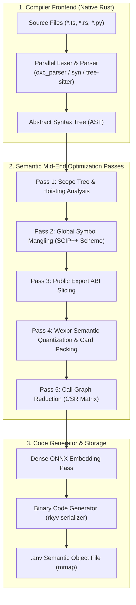
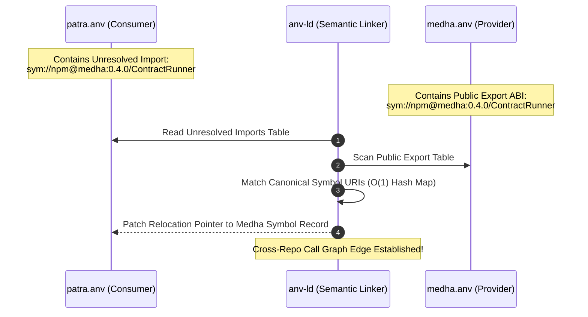

# RFC: The Anvesa Semantic Compiler (`anvc`)
## Beyond SCIP: Compiling Source Code to Semantic Knowledge Objects

> [!NOTE]
> **Status**: Proposed Architecture RFC  
> **Target**: Anvesa Pillar 4 (Graph Intelligence & Code Compilers) & Pillar 6 (Federation)  
> **Key Technologies**: Rust, `oxc_semantic`, `syn`, `rkyv`, Memory-Mapped I/O (`mmap`), AVX-512 SIMD

---

## 1. Executive Summary: The Evolution from SCIP to `anvc`

In our companion specification ([`docs/scip-ingestion.md`](file:///e:/AI%20projects/sutras/anvesa/docs/scip-ingestion.md)), we established that **SCIP** (*Source Code Intelligence Protocol*) solves cross-repository symbol naming through universal descriptors.

However, **SCIP is only an interchange format**—it is not a compiler. Relying purely on SCIP introduces severe practical bottlenecks:
1. **Toolchain Friction**: Users must install and configure separate external compilers (`scip-typescript`, `rust-analyzer scip`, `scip-go`, `scip-python`) for every repository.
2. **Missing AI Modalities**: SCIP only models syntax ranges and symbol names. It has no concept of **token budgeting, docstring intent normalization, semantic cards, or dense vector embeddings**.
3. **Database Ingestion Overhead**: Protobuf files must be parsed and inserted into a separate relational engine (SQLite), encountering disk write serialization and lock friction.

**The Solution**: We introduce **`anvc` (The Anvesa Semantic Compiler)** and its partner **`anv-ld` (The Anvesa Semantic Linker)**.

Instead of translating source code to machine instructions ($x86/\text{ARM}$) or relying on external indexing daemons, `anvc` compiles source files directly into **Anvesa Semantic Objects (`.anv`)**—zero-copy, memory-mapped binary artifacts containing symbols, call graphs, token-budgeted cards, and pre-computed vector embeddings.

---

## 2. Comprehensive Comparison: SCIP vs. `anvc`

| Dimension | **SCIP (Sourcegraph)** | **`anvc` (Anvesa Semantic Compiler)** |
| :--- | :--- | :--- |
| **Primary Identity** | Static Serialization Protocol (Protobuf) | **Active Native Compiler Pipeline & Linker** |
| **Frontend Execution** | External 3rd-party CLIs (`scip-typescript`, etc.) | **Self-contained Rust frontends** (`oxc_semantic`, `syn`, Tree-sitter) |
| **Target Architecture** | Raw occurrences & syntax ranges | **Multi-modal IR**: Graph + Wexpr Cards + Dense Vectors |
| **Storage Model** | `.scip` Protobuf file $\to$ SQLite database | **`.anv` zero-copy memory-mapped binary (`mmap`)** |
| **Startup / Cold Latency**| 50 ms – 500 ms (Protobuf decode / SQL connection) | **< 0.2 ms** (direct pointer arithmetic in virtual memory) |
| **Vector Embeddings** | ❌ None (pure AST/syntax only) | ✅ **Native** (contiguous `Float32Array` aligned for AVX-512) |
| **LLM Context Readiness**| ❌ Raw lines (subject to token overflow & syntax poisoning) | ✅ **Wexpr Cards** (pre-budgeted intent + ABI contracts) |
| **Cross-Repo Linking** | Post-hoc SQL string matching across databases | **`anv-ld`** (dynamic linker binding unresolved symbol tables) |
| **Incremental Builds** | Full-repo re-index or external CI diff | **Fine-grained Merkle DAG** (< 5ms incremental recompilation) |

---

## 3. The `anvc` Compilation Pipeline

The compiler is organized into traditional compiler phases, re-architected for code intelligence:



### 3.1 Pass Breakdown

#### Pass 1: Scope & Binding Analysis
Using high-speed Rust-native semantic engines (e.g. `oxc_semantic` processing 3M+ lines/sec), `anvc` resolves lexical block scopes, variable hoisting, and shadowed identifiers. It maps every identifier reference directly to its declaration node.

#### Pass 2: Global Symbol Mangling (The SCIP++ Standard)
`anvc` adopts and extends the SCIP universal naming convention into an internal URI format:
```text
sym://<package-manager>@<package-name>:<version>/<file_path>#<Namespace>.<Type>.<Member>(<Params>)
```
* Internal symbols (private helpers, local closures) are mangled with file hashes.
* Public exports are preserved as canonical descriptors for external linking.

#### Pass 3: Public Export ABI Slicing
The compiler determines the exact external contract of the module:
- Which symbols are reachable from outside?
- What are their parameter types, return signatures, and documentation annotations?
- Implementation bodies of exported functions are separated from the public contract.

#### Pass 4: Wexpr Semantic Quantization
As demonstrated in empirical PCA experiments, raw source code triggers syntax poisoning and overflows token windows. In this pass, `anvc`:
1. Strips internal loops, branch keywords, and temporary variables.
2. Decomposes compound identifiers into natural language words (`FederatedRetriever` $\to$ `federated retriever`).
3. Normalizes docstring comments.
4. Packs the result into deterministic **W-expression Cards** bounded by the target model's token budget.

#### Pass 5: Call Graph CSR Matrix Generation
Call expressions are resolved into a **Compressed Sparse Row (CSR)** adjacency graph:
- In-memory traversal of callers and callees requires zero string comparisons.
- PageRank and Repomap importance calculations run in microsecond loops over flat integer arrays.

---

## 4. The `.anv` Binary Layout Specification

A `.anv` file is an immutable, memory-mapped binary designed for **zero-copy deserialization** via Rust's [`rkyv`](https://github.com/rkyv/rkyv). Opening an index requires no decoding, no allocations, and no database query planning.

```
+-------------------------------------------------------------------------+
|                              HEADER (64 bytes)                          |
|  - Magic Bytes: 0x41 0x4E 0x56 0x53 ('ANVS')                            |
|  - Format Version: 1                                                    |
|  - Content Merkle Root (SHA-256)                                        |
|  - Section Table Offsets & Sizes                                        |
+-------------------------------------------------------------------------+
|                           STRING INTERNING TABLE                        |
|  - Deduplicated null-terminated UTF-8 strings (paths, identifiers, docs)|
+-------------------------------------------------------------------------+
|                            SYMBOL TABLE (Fixed)                         |
|  - Array of SymbolRecord structs (ID, name_off, kind, line, span, flags)|
+-------------------------------------------------------------------------+
|                        PUBLIC EXPORT TABLE (ABI)                        |
|  - Exported symbol descriptors exposed for cross-repo linking           |
+-------------------------------------------------------------------------+
|                       UNRESOLVED IMPORTS TABLE                          |
|  - External symbol requirements to be resolved by anv-ld                |
+-------------------------------------------------------------------------+
|                         CALL GRAPH (CSR Matrix)                         |
|  - Row Pointers: uint32[]                                               |
|  - Column Indices (Callees): uint32[]                                   |
|  - Edge Weights: float32[]                                              |
+-------------------------------------------------------------------------+
|                         WEXPR CARDS SECTION                             |
|  - Pre-packed tokenized card text blocks for LLM retrieval              |
+-------------------------------------------------------------------------+
|                       DENSE VECTOR SECTION (SIMD)                       |
|  - 64-byte aligned contiguous Float32 array                             |
|  - Directly executable via AVX-512 / NEON dot-product kernels           |
+-------------------------------------------------------------------------+
```

### Zero-Copy Access in Rust
```rust
// Reading an entire repository's symbol graph:
let mmap = unsafe { Mmap::map(&file)? };
let archive = rkyv::check_archived_root::<AnvObject>(&mmap[..])?;

// Zero allocations: pointers refer directly into OS virtual memory
let symbol = archive.symbols.lookup_by_id(42);
println!("Symbol: {}, Line: {}", symbol.name(&archive), symbol.start_line);
```

---

## 5. The Linker: `anv-ld` (Cross-Repo Dynamic Linking)

Just as the system linker (`ld` / `lld`) links compiled `.o` files into an executable by resolving unresolved symbol references, **`anv-ld`** links federated repositories across the `sutras/` ecosystem:



### Advantages of the Semantic Linker Model
1. **True Polyrepo Independence**: `medha` and `patra` can be compiled independently at different times on different machines.
2. **Instant Re-linking**: When `medha` changes, only `medha.anv` is recompiled. The linker patches the cross-repo boundary in **< 1 millisecond**.
3. **Compiler-Grade Blast Radius**:
   ```bash
   anv-ld blast-radius --from medha.anv --symbol "ContractRunner#execute"
   # Output:
   # -> patra.anv: src/workflow.ts:18:4 [VERIFIED COMPILER LINK]
   ```

---

## 6. Incremental Compilation via Merkle Dependency DAG

Traditional language servers re-evaluate large dependency trees on every keystroke. `anvc` uses a **content-addressable Merkle DAG** (inspired by Bazel and Turbopack):

```
       File A (src/types.ts) ──► Hash: 0x9a4f (Public ABI unchanged)
                 │
                 ▼
       File B (src/engine.ts) ──► Re-compilation SKIPPED (Cache Hit)
```

1. **ABI Hash vs. Body Hash**:
   - If a developer edits the internal implementation of a private helper inside `engine.ts`, its **Body Hash** changes, but its **ABI Hash** remains identical.
2. **Short-Circuit Invalidation**:
   - Downstream files in the current repository and federated peer repositories do not need recompilation or re-embedding.
   - Typical incremental compile latency: **< 5 milliseconds**.

---

## 7. Strategic Evolution: Transitioning from SCIP to `anvc`

To maintain backward compatibility and pragmatism, Anvesa adopts a three-phase transition:

### Phase 1: SCIP Ingestion (The Compatibility Layer)
* Support external `.scip` Protobuf files via `crates/anvesa-store`.
* Normalize SCIP universal symbol strings into SQLite.
* Validate cross-repo blast radius queries across federated repositories.

### Phase 2: Embedded Frontend Integration (`anvc` Prototype)
* Embed `oxc_semantic` into `crates/anvesa-syntax` to eliminate `scip-typescript` for all JS/TS projects.
* Generate native symbol tables and export ABIs directly inside Anvesa without external CLIs.

### Phase 3: The `.anv` Binary & Semantic Linker (`anv-ld`)
* Introduce the memory-mapped `.anv` format alongside SQLite.
* Enable `anv-ld` for instant cross-repo dynamic linking across the `sutras` ecosystem.
* Benchmark vector search performance: target **10x speedup** via memory-mapped SIMD over SQLite BLOB scans.
